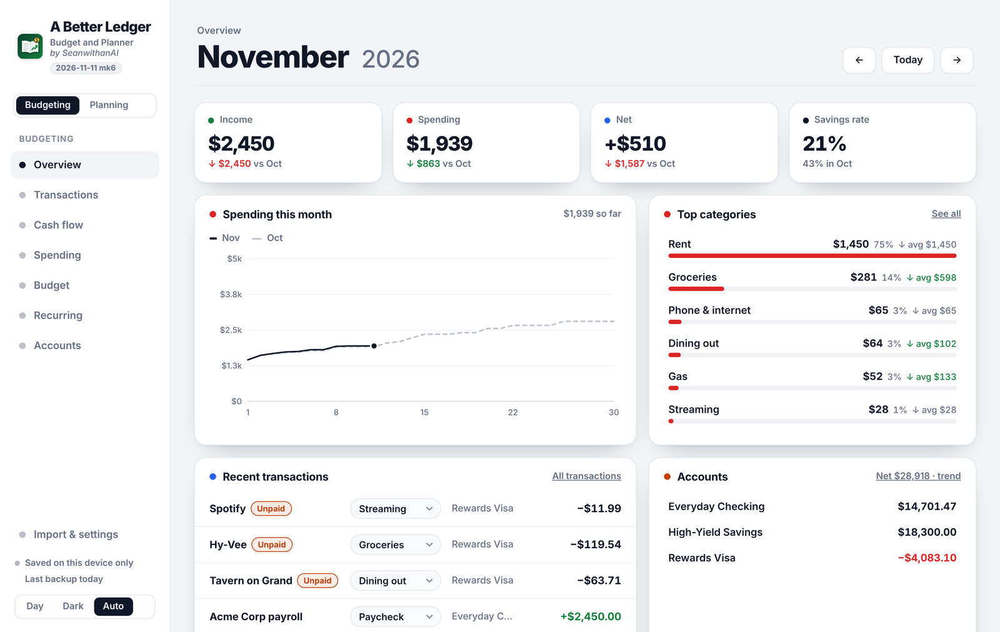
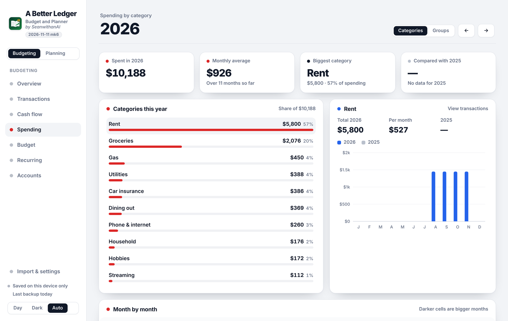
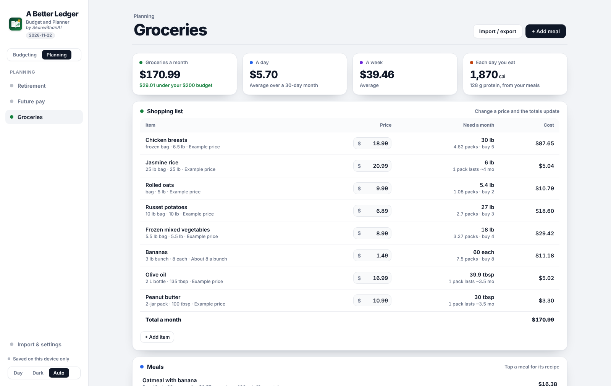

# A Better Ledger

**Budget and Planner: a private, single-file replacement for Monarch and Actual Budget**

**[▶ Open it online](https://seanwithanai.github.io/A-Better-Ledger/)** · nothing to install · your data stays on your device

*by SeanwithanAI*

---

## Overview

A Better Ledger tracks your accounts, transactions and monthly budget, and plans for retirement, future pay, your tax refund and groceries. Everything is in one HTML file: there's nothing to install, no subscription, and no third party ever holds your financial data.

It can bring in your history from **Actual Budget**, and export a file Actual can read back, so you're never locked in.

## Features

### Budgeting
| | |
|---|---|
| **Overview** | Income, spending, net and savings rate for the month, compared with last month. Includes a running spending chart, top categories, recent transactions and account balances. |
| **Transactions** | Every transaction in one list, with categories, notes and attachments (receipts, PDFs, photos). |
| **Cash flow** | Money in against money out, month by month. |
| **Spending** | Spending by category or group for the year, with monthly trends and a year-over-year comparison. |
| **Budget** | Monthly amounts per category, grouped (Bills, Everyday…). Fill empty months from your 3-month average, and save up for irregular bills. |
| **Recurring** | Scheduled transactions (rent, subscriptions, paychecks) added automatically when they come due. Annual and twice-a-year bills can be **saved up for every month** (the yearly total ÷ 12), and monthly bills in the same category added in, plus an optional **extra each month** (for costs without a set bill, like car repairs), to set the category's budget, with a check that the money will be there in time. |
| **Accounts** | Checking, savings, credit cards with payment tracking, and off-budget accounts such as investments and loans. Tick a credit card and its next payment shows as **pending** on the account you pay from (Checking by default): under its balance on Accounts and Overview, and as pending rows at the top of its transactions, with the balance after. **Savings goals** set a balance to reach for an account and show when you'd get there, on your budget and at your recent pace. |

### Planning
| | |
|---|---|
| **Retirement** | Projects your savings to retirement age and tells you whether you're on track, and roughly how much more to invest if you're not. |
| **Groceries** | A monthly shopping list built from the meals you make. Add what you buy (pack size and price) and each meal's ingredients, recipe and how often you eat it (meals for guests included); it works out how much of each item you need a month, how many packs to buy, and what it all costs a month, week and day. Change a price and everything updates. Set a grocery budget, see if you're over or under, and copy the total into your budget category in one tap. Plans can be shared as a file, and the shopping list exported as a spreadsheet (.csv). |
| **Future pay** | Plans upcoming paychecks and take-home pay for any US state (federal W-4, state income tax, paid leave, local tax, any retirement plan), and can feed expected income into the budget. Projects your pay all the way to the year you retire and averages your last 5 years for the Retirement calculator. |
| **Tax refund** | Estimates your federal and state refund (or what you'd owe) for this year and the next two. Each paycheck comes from Future pay, adding up what's withheld, and the tax you'd owe is worked out on the year's total. Enter your latest paystub's year-to-date totals, another job's pay, other income, deductions and credits to make it closer. It also suggests W-4 or W-4MN changes that would bring the refund near $0. You can type in new brackets, standard deductions, filing status or state when they change. |

### Also included
- **Import from Actual Budget**, and **export** a file Actual can import.
- **Backup and restore** to a single JSON file.
- **Day, Dark and Auto** themes. Works on phones, tablets and desktops.
- **Download app + data.** In **Data → Back up**, one click downloads a .zip with this version of the app, a backup of your data, and a short note on how to restore it. Open the HTML anywhere and restore the backup to pick up where you left off. In PageVault it's the exact file that's installed.

## Screenshots

| Spending by category | Overview |
|---|---|
|  |  |

Screenshots use made-up example data.

## Future pay and taxes

Future pay shows how your salary moves through your employer's pay ranges, and what each paycheck will actually be after taxes and deductions. Everything is set under **Future pay → Paycheck details**.

| Setting | What you can enter |
|---|---|
| **Match your paystub** | Type in the taxes from a regular paycheck (federal, state, Social Security, Medicare, paid leave) and each one is adjusted to match. The adjustment is kept as a percentage, so it stays matched as your pay changes, and it flows into expected income on the Budget page and the tax refund estimate. **Stop matching** goes back to the calculated amounts. |
| **Federal (W-4)** | Filing status (Single, Married filing jointly, Head of household), the Step 2 "two jobs" box, Step 3 dependent credits, Step 4(a) other income, Step 4(b) deductions and Step 4(c) extra withholding. |
| **Social Security and Medicare** | Social Security stops at the yearly wage limit ($184,500 in 2026), and the extra 0.9% Medicare starts above $200,000. A switch turns off Social Security for jobs that don't pay into it (some teachers, police, firefighters and government jobs). |
| **State** | Any of the 50 states or DC, with your state filing status, dependents and extra state withholding. States with no income tax on wages are marked. |
| **Paid leave / disability** | Your state's employee rate fills in when you pick the state (for example California SDI 1.3%, New York paid family leave 0.432%, Paid Leave Oregon 0.6%). You can change it to match your paystub. |
| **Local income tax** | A % for city, county or school-district wage taxes. A note points it out for states where these are common (Maryland, Ohio, Pennsylvania, Michigan, New York City and others). |
| **Retirement** | Any plan you name (401(k), 403(b), 457, a pension…), the % you put in, and whether it's **pre-tax** or **Roth**. Extra 401(k), 457 or HSA amounts can also be added as deductions. |
| **Pay and deductions** | Extra pay items (taxed, not taxed, or taxable benefits) and deductions (pre-tax health, pre-tax retirement, after-tax), on every paycheck or only the last one of the month. |

**At retirement.** Enter your age and retirement age (shared with the Retirement page) to see your retirement date, your salary when you retire, and the average of your last 5 years, year by year. The chart and raise table can run all the way to retirement (**To retire**). Every amount also shows what it's worth in today's money. **Use in retirement calculator** makes the pension use that average, and it stays in sync when your pay settings change. Turn off *Use my Future pay projection* on the Retirement page to go back to a flat raise %.

**How accurate it is**
- **Federal** follows the IRS's 2026 payroll tables (Publication 15-T) and should match your paystub.
- **Minnesota** uses the state's own payroll formula and matches the state's withholding to the cent.
- **Other states** are estimated from each state's 2026 tax brackets, standard deduction and exemptions, applied to a year of pay. They're usually within a few dollars a paycheck of what your employer withholds, but they don't use each state's own payroll formula. Pennsylvania's tax on retirement contributions and Oregon's federal-tax subtraction are included.
- **Future years** raise the tax brackets by the % you choose (2.5% by default). Withholding is not your final tax bill.

## Tax refund

**Planning → Tax refund** estimates your federal and state refund, or what you'd owe, for this year and the next two. It needs **Future pay** set up, because it works from your paychecks.

1. **Withholding.** Every payday in the year is built from Future pay: your salary on that date, your W-4, retirement and other deductions, and your state settings. What's withheld from each one is added up. Years with an extra payday (27 instead of 26) are called out.
2. **What you'd owe.** The tax is worked out on the year's total, the way your return does it: taxable wages plus other income, minus the standard deduction and any other deductions, run through the brackets, minus credits.
3. **The refund** is what was withheld minus what you'd owe, for federal and your state. If it's far from $0, it suggests a W-4 (or W-4MN) change that would bring it closer. That's optional; some people like a refund.

**Make this year accurate.** Enter your latest paystub's date and year-to-date taxable wages and withholding. Only the paychecks after that date are projected. If you changed jobs during the year, add the old job's wages and withholding too.

**Deductions.** Enter your mortgage interest, property taxes, donations, out-of-pocket medical costs and overtime pay once a year. Each year it works out whether itemizing beats the standard deduction, separately for federal and your state, and uses the bigger one:
- Federal itemizing adds your state income tax for the year (from the withholding it already estimates) to your property taxes, capped at $40,000 for 2025–2029 (growing 1% a year, lower above $500,000 of income, $10,000 after). Medical costs count above 7.5% of income, and from 2026 donations count above 0.5% of income.
- Taking the standard deduction from 2026 on, up to $1,000 of donations ($2,000 married) is still deducted.
- The overtime deduction (2025–2028) takes the extra half-pay part of your overtime, up to $12,500 ($25,000 married), phasing out above $150,000 ($300,000).
- Minnesota itemizing leaves out state income tax, and if you take Minnesota's standard deduction, half of your donations over $500 is subtracted.
- Other adjustments (IRA or HSA contributions you made yourself, student loan interest) lower both federal and state income.

**Other income and credits.** Add interest or side income (it shows your interest from the last 12 months), and federal and state credits. Minnesota's Homestead Credit Refund (M1PR) is a separate refund and isn't included.

**Tax rules.** Built in are the 2026 federal brackets and standard deduction, Minnesota's 2026 brackets and standard deduction, and other states' 2026 rules, grown each later year by the inflation rate in Future pay. Tap **Tax rules** to:
- type in new brackets or standard deductions when they're announced, federal or state,
- change your filing status on the return, or
- pick a different state for the return (withholding still follows the state in Future pay, so change it there too if you move).
- say whether you lived in the state all year, part of the year (you moved) or not at all (you only worked there). Part-year residents and nonresidents pay the state's tax on all their income times the share earned there, the way Minnesota's Schedule M1NR works.

A year you save is used for the years after it as well, grown for inflation, until you save a later year. **Undo** goes back to the built-in rules for that year. The page shows which rules each year is using.

It's an estimate to plan with, not tax advice. It leaves out credits you haven't entered, local income taxes and a spouse's income.

## Groceries

**Planning → Groceries** turns the meals you eat into a monthly shopping list and a grocery budget. It works for any store and any diet; nothing is built in except an example plan you can load to see how it works.

1. **Add what you buy.** For each item, enter what a pack is (a bag, a 12-pack…), how much is in it and what it's measured in (6.5 lb, 12 each, 135 tbsp…), and the price. Use **Extra a month** for things you use but don't cook with, like coffee or snacks.
2. **Add your meals.** Pick the items one serving uses and how much of each, how many times a month you eat it (shortcuts for every day, workdays, weekends or once a week), and the steps to make it. Calories and protein a serving are optional; fill them in and the page shows what you eat in a day.
3. **Read the list.** For every item you see how much you need a month, how many packs that is and how many to buy, or how long one pack lasts for things like rice and oil. Totals show the cost a month, a week and a day.
4. **Keep prices current.** Type a new price straight into the list after a shopping trip and every total updates.
5. **Fit it in your budget.** Enter a monthly grocery budget to see if you're over or under. Pick your groceries category and add anything else paid from it each month (toilet paper, cleaning supplies). Turn on **Fill in this category's budget from this plan** and choose the month it starts: the category's budget becomes the grocery total plus what you added, and it follows along whenever you change a price or meal. Months before that keep their own budget, and turning it off keeps the last amount. The Budget page marks the category **from Groceries**.

**This week.** A week plan at the top of the page shows what to make each day, from Monday to Sunday. It's built from how often each meal is planned, so two snacks planned 15 times a month each alternate. **Next up** shows the meal to eat next for the time of day, today's meals that are done fade out, and a day with a step that starts with its name (like "Sunday batch cook") is marked as a prep day. Tap a meal to see its recipe or swap it for another meal at the same time of day. Swaps are kept for that day of the week, and **Undo my swaps** goes back to the automatic plan.

**Meals for guests.** Tick **For guests** on a meal (pizza or snacks for when people come over) and its cost counts in your groceries but not in your own calories and protein.

**Recipes.** Tap any meal to see its ingredients for one serving and the steps, numbered. **Edit meal** changes them.

**Sharing a plan.** **Import / export** downloads your plan as a file someone else can import (add it to their plan, or replace theirs), or the shopping list as a .csv for a spreadsheet. Your plan is also saved with the rest of your ledger and included in every backup.

## Getting started

**Option 1: open the file.** Download the newest `A_Better_Ledger_<date>_by_SeanwithanAI.html` (or `…_<date>_mkN_by_…` for a later release that day) and open it in any modern browser. Click **Import from Actual Budget** or **Start with an empty account**.

**Option 2: host it on PageVault (recommended).** Install it as an app in [PageVault](#hosting-on-pagevault) on your own server. Your ledger is then saved on your server, follows you to any device, and each family member gets their own private ledger.

## Opening the file on your devices

**Easiest: the web link.** Open **[seanwithanai.github.io/A-Better-Ledger](https://seanwithanai.github.io/A-Better-Ledger/)** on any phone, tablet or computer. It's this same app, served by GitHub, and it always has the newest version. Nothing is sent anywhere: your data is saved in that browser on that device, just like the downloaded file. On iPhone or iPad, open it in Safari, tap **Share** (on iOS 26 and later, tap **•••** first), then **Add to Home Screen** to keep it like an app. On Android, use Chrome's **⋮ → Add to Home screen**.

Prefer to keep your own copy of the file? The steps below cover that.

The app is one self-contained `.html` file: no install, no account, nothing else to download. Download `A_Better_Ledger_<date>_by_SeanwithanAI.html`: open it in the file list above, then use the **Download raw file** button (↓) at the top right of the file view.

**Desktop (Windows, macOS, Linux)**
1. Download the file and move it somewhere permanent, like Documents.
2. Double-click it. It opens in your default browser (Chrome, Edge, Firefox, Safari and Brave all work).
3. Bookmark it, and always open it the same way: same file, same place, same browser. Your data is saved in that browser for that file, so a copy in another folder or another browser starts empty.

**iPhone and iPad**
**Because of iOS, an HTML file saved on your iPhone or iPad can't be opened in Safari.** iOS doesn't offer Safari as a way to open it, and tapping the file in the Files app only shows a preview with the buttons turned off. Use one of these instead:
- **The web link (recommended).** See above.
- **PageVault.** Open the app's PageVault link in **Safari**, then tap **Share** (on iOS 26, tap **•••** first, then **Share**). Scroll down the list and tap **Add to Home Screen**. If it isn't there, tap **Edit Actions** at the bottom of the list and add it. It then opens like a regular app, and your data is saved on your server and syncs with your other devices.
- **Microsoft Edge (may work).** Save the file to the Files app, then try opening it with Edge (in Files, open the file, tap **Share** and choose **Edge**). Keep backups: data saved this way can be lost if Edge clears its storage.

**Android**
1. Download the file in Chrome.
2. Open it from Chrome: **⋮ → Downloads** and tap the file (or from the Files app, **Open with → Chrome**).
3. Open it from Chrome's Downloads each time. A home-screen shortcut to a downloaded file may stop working after Chrome restarts.
4. Turn on backups (the app reminds you every 7 days), or use **PageVault** and **⋮ → Add to Home screen** so your data lives on your server instead.

**Moving to another device:** download a backup in the app, open the same version on the new device, and restore the backup there. With PageVault there's nothing to move.

## Where your data is stored

| Opened from… | Saved to | Status shown in the app |
|---|---|---|
| **PageVault** | Your own server, separately for each signed-in person. Nothing is kept in the browser. | *Saved to your server* |
| **A local file** | This browser only. Saved in the browser's large storage, along with attachments, with room for years of data; the app asks the browser to keep it rather than clear it to free up space. | *Saved on this device only* |

When data lives in only one browser, the app reminds you every 7 days to download a backup.

**Conflict protection (PageVault):** if the ledger is open on two devices, an out-of-date screen can't overwrite newer data. It asks you to reload instead.

## Hosting on PageVault

PageVault watches this repository and installs new versions automatically (or with one tap). Each update keeps the app's link and everyone's saved data. Releasing a new version is just adding the new file here; see **Versioning** below.

## Versioning

Only the newest release is kept in the repo: `A_Better_Ledger_2026-11-25_mk4_by_SeanwithanAI.html`. Each new release replaces it, and `docs/index.html` (what the web link opens) is updated to match. Your data isn't stored in the file, so moving to a new release keeps it (if you use the downloaded file, open the new one the same way as before, in the same browser, and download a backup first to be safe).

Releases are named with their date. The first release of a day is just the date; later releases that same day add `mk1`, `mk2`, `mk3`… (the count starts over each day). The version is also shown inside the app.

### Changelog

Every release so far, newest first. Older releases are listed for reference; only the current one is available to download.

| Version | Notes |
|---|---|
| **2026-11-25 mk4** | **Backup reminders on phones.** The 7-day backup reminder is now checked again whenever the app comes back on screen, and every hour while it stays open. A tracker added to a phone's Home Screen is usually resumed instead of reloaded, so before this the reminder could be missed for weeks. **Remind me tomorrow** now ends the next day even if the app was never closed. |
| **2026-11-25 mk3** | **Itemized deductions in Tax refund.** Enter your mortgage interest, property taxes, donations, medical costs and overtime pay, and each year the estimate uses whichever is bigger, itemizing or the standard deduction, for federal and your state separately. Federal includes your state income tax and property taxes under the SALT cap, the 2026 donation rules and the overtime deduction; Minnesota itemizing leaves out state income tax and gives non-itemizers its donations subtraction. Also adds state tax credits and moves IRA, HSA and student loan interest to **Other adjustments**, which lower both federal and state income. |
| **2026-11-25 mk2** | **Match your paystub, and residency.** Future pay's **Paycheck details** has a new **Match your paystub** section: type in the federal, state, Social Security, Medicare and paid-leave amounts from a regular paycheck and each tax is adjusted to match, as a percentage so it stays matched as your pay changes. Take-home pay, expected income on the Budget page and the tax refund all use the matched amounts. In **Tax refund → Tax rules** you can now say whether you lived in the state all year, part of the year or not at all; part-year residents and nonresidents pay the state's tax on the share of income earned there. |
| **2026-11-25 mk1** | **Tax refund.** A new **Planning → Tax refund** page estimates your federal and state refund, or what you'd owe, for this year and the next two. It adds up the withholding on every paycheck from Future pay (your salary on each payday, W-4, deductions and state settings), then works out the tax you'd really owe on the year's total: the 2026 federal brackets and standard deduction, Minnesota's 2026 brackets and standard deduction ($15,300 single, $30,600 married), or your state's yearly brackets. Later years grow with your Future pay inflation setting. For this year, enter your latest paystub's year-to-date wages and withholding, plus another job's if you changed jobs, and only the paychecks after it are projected. You can add other income (it shows your interest from the last 12 months), extra deductions and credits. Years with 27 paydays are called out, and it suggests W-4 or W-4MN changes to bring the refund near $0. **Tax rules** lets you type in new brackets and standard deductions when they're announced (federal and state), or change your filing status or the state on your return. A year you save is used for later years too, grown for inflation, until you save a later one, and **Undo** goes back to the built-in rules. |
| **2026-11-25** | **Savings goals.** On the Accounts page, tap **+ Set a goal**, pick an account (like your savings account), and enter the balance you want to reach, with an optional name and a month to reach it by. The goal shows your progress and when you'd reach it two ways: **on your budget** (what's budgeted to go into the account each month, minus bills paid from it, including bills you save up for there) and **at your recent pace** (the account's average change over its last 6 full months). With a reach-by month, it tells you if you're on track or how much more to save each month. You can also link the savings category whose money goes into the account right from the goal. |
| **2026-11-22 mk2** | **A week plan for your meals.** The Groceries page now opens with **This week**: pick a day to see its breakfast, lunch, snack, dinner and anytime items with their calories, plus a **Next up** card for the meal to eat next. Snacks or meals planned less than daily alternate through the week, the day's prep is called out (like a Sunday batch cook), and you can tap any meal to see the recipe or swap it for that day. Works on phones. |
| **2026-11-22 mk1** | **Groceries fills in your budget.** On the Groceries page, pick your groceries category, add anything else paid from it each month (like toilet paper), and turn on **Fill in this category's budget from this plan**. From the month you choose, the category's budget is the grocery total plus that amount, and it updates when you change a price or a meal. The Budget page shows it as **from Groceries**; earlier months keep their own budget, and turning it off keeps the last amount. |
| **2026-11-22** | **Groceries.** A new **Groceries** page under Planning. List what you buy with its pack size and price, then add your meals: the ingredients for one serving, how many times a month you eat it, optional calories and protein, and the recipe steps. Mark a meal **For guests** (like pizza when friends come over) and it counts in your grocery cost but not in your calories and protein. The shopping list fills in how much of each item you need a month, how many packs to buy (or how long one lasts), and the cost, with totals for the month, week and day and your daily calories and protein. Edit any price right in the list and the totals update. Set a monthly grocery budget to see if you're over or under, and pick your groceries category to set its budget to the plan's total, plus anything else that comes out of it (like toilet paper). **Import / export** downloads the plan as a file to share or move, or the shopping list as a .csv; there's an example plan to start from. |
| **2026-11-20** | **Bills you save up for count as savings.** When a savings category gets whatever is left over, the money you put aside for annual and twice-a-year bills (in a group that sets money aside in a savings account) now shows as savings, not spending. The Budget banner reads like "$3,519 to spending and $960 to savings ($341 of it for bills you save up for)", the **Saved** tile's plan includes the bills, and money moved into that account for the bills this month counts as saved. The amount left over for savings itself is unchanged. |
| **2026-11-19** | **Save extra on top of your bills.** A category that saves up for its bills can now also put aside a set amount every month, for costs without a set bill (like car repairs). Tap the category on the Budget page, or **+ Save extra each month** under Recurring → Bills in your budget, and enter the amount. The category's budget becomes its bills ÷ 12 plus the extra, it rolls over with the rest, and it shows as "+ $68 extra" on the Budget page. The check that the money will be there for each bill doesn't count the extra, so it stays set aside for those other costs. |
| **2026-11-16 mk5** | PageVault save status is accurate: a change on its way now shows **Saving to your server…** instead of briefly saying **Can't reach your server**, which only appears if a change still hasn't gone through after 10 seconds. |
| **2026-11-16 mk4** | **No attachment size limit, and backups include attachments.** Receipts and files of any size can be attached (the 20 MB limit is gone). When transactions have attachments, **Download backup** makes a .zip with your data and every attachment, so they come along when you restore on another device or into PageVault; restoring puts them back. Big files are added without loading them all into memory. Without attachments the backup is a plain .json file, as before. The app asks the browser to keep its data, and says so plainly if the browser ever can't save. |
| **2026-11-16 mk3** | **Use it online.** The app now has a web link, [seanwithanai.github.io/A-Better-Ledger](https://seanwithanai.github.io/A-Better-Ledger/), that works on any device, including iPhone and iPad, and always has the newest version. The preview shown when the file can't run points to it. |
| **2026-11-16 mk2** | The preview now says plainly that, because of iOS, an HTML file saved on an iPhone or iPad can't be opened in Safari, and points to PageVault instead. |
| **2026-11-16 mk1** | The preview shown when the file can't run (like in the iPhone Files app) now explains how to open it on a computer, Android, iPhone and iPad. |
| **2026-11-16** | **Privacy clean-up.** No card names or paycheck amounts are built in any more: new installs start with neutral take-home defaults, and Monarch imports match a card like “Visa Signature (...1234)” to an account you already have with that name. Your saved accounts, cards and pay settings are unchanged. |
| **2026-11-15 mk3** | **Monthly bills count too.** Recurring monthly bills (like phone installments and subscriptions) can be counted in their category's budget alongside the annual ones, with a one-tap **Count them** on Recurring. **Savings gets what's left:** turn on *Save whatever is left over* for a savings category and its plan becomes the month's income minus everything else you've planned, so raising a category lowers savings automatically. |
| **2026-11-15 mk2** | Same as 2026-11-15 mk1, re-released so PageVault picks up the update. |
| **2026-11-15 mk1** | **Saving up for bills.** Mark an annual, twice-a-year or every-few-months recurring bill as **Save up for it every month**: its category's budget becomes the yearly total of those bills ÷ 12 and rolls over, so the money is there when it's due. A **Saving up for bills** card on Recurring shows each category's monthly and yearly amounts, what's set aside, and whether you'll be short before the next bill, with a one-tap catch-up. |
| **2026-11-15** | **Phone keyboard fix.** Pop-up forms now fit above the on-screen keyboard and keep the field you're typing in visible, instead of sliding it out of view on iPhone. |
| **2026-11-14 mk1** | **Download app + data (.zip)** replaces Download this app: one click gives a zip with the app's HTML, your backup and a how-to-restore note. |
| **2026-11-14** | **Download this app** in **Data → Back up**: the HTML file for this version, to keep or run on its own. |
| **2026-11-13 mk1** | Card payments as pending: ticked cards show their next payment as a pending payment on the account you choose. You'll see *−$X pending · $Y after* under that account's balance on Accounts and Overview, and pending rows with running balances at the top of its transactions. Replaces the payoff preview box. Nothing is recorded until you use **Pay**. |
| **2026-11-13** | Credit card payoff preview: tick the cards you'd pay, pick the account it comes from and *Next payment* or *Full balance*, and add any pending charges your bank shows that aren't in the ledger yet. *If you paid these now* shows that account's balance after paying (red if it isn't enough), and Overview shows the same number. Preview only, nothing is paid. |
| **2026-11-12 mk2** | Pension autofills from Future pay. Choose what it's based on (final year, or highest 3, 4, 5, 8 or 10 years). The pension shows a yearly amount when it starts plus the same in today's money, on both Retirement and Future pay. *At retirement* adds today's-money values for your final salary, the average and each year. Retirement tiles say which are in today's money, and *Needed at retirement* also shows future dollars. |
| **2026-11-12 mk1** | Future pay projects to your retirement: an *At retirement* card (age and retire age shared with Retirement), salary when you retire, and the average of your last 5 years, broken out year by year. A *To retire* view runs the chart and raise table through retirement. The Retirement calculator can use that 5-year average for the pension (*Use my Future pay projection*) instead of a flat raise %. |
| **2026-11-12** | Future pay works for every state: pick your state (all 50 + DC, 2026 brackets), state filing status, Head of household, W-4 Steps 2–4, Social Security wage cap and on/off switch, any retirement plan (pre-tax or Roth), state paid leave and local income tax. Minnesota keeps its exact formula; older saved settings carry over. |
| **2026-11-11 mk6** | Saves to the PageVault server (data and attachments) when hosted there, with no browser copy. Behaves as before everywhere else. |

A Better Ledger · Budget and Planner · by SeanwithanAI

