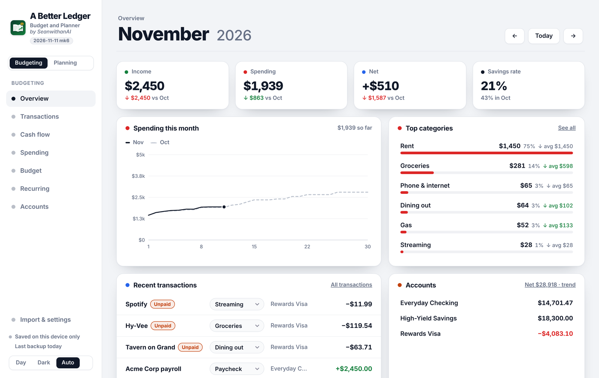
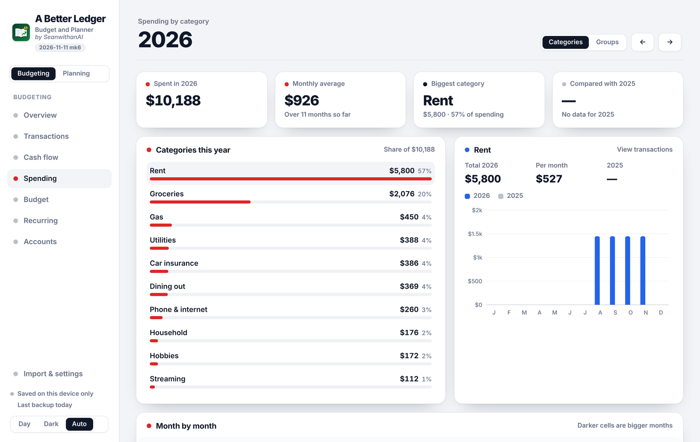

<div align="center">

# A Better Ledger

**Budget and Planner: a private, single-file replacement for Monarch and Actual Budget**


*by SeanwithanAI*

</div>



---

## Overview

A Better Ledger tracks your accounts, transactions and monthly budget, and plans for retirement and future pay. Everything is in one HTML file: there's nothing to install, no subscription, and no third party ever holds your financial data.

It can bring in your history from **Actual Budget**, and export a file Actual can read back, so you're never locked in.

## Features

### Budgeting
| | |
|---|---|
| **Overview** | Income, spending, net and savings rate for the month, compared with last month. Includes a running spending chart, top categories, recent transactions and account balances. |
| **Transactions** | Every transaction in one list, with categories, notes and attachments (receipts, PDFs, photos). |
| **Cash flow** | Money in against money out, month by month. |
| **Spending** | Spending by category or group for the year, with monthly trends and a year-over-year comparison. |
| **Budget** | Monthly amounts per category, grouped (Bills, Everyday…). Fill empty months from your 3-month average, and save up for irregular bills. |
| **Recurring** | Scheduled transactions (rent, subscriptions, paychecks) added automatically when they come due. |
| **Accounts** | Checking, savings, credit cards with payment tracking, and off-budget accounts such as investments and loans. Tick a credit card and its next payment shows as **pending** on the account you pay from (Checking by default): under its balance on Accounts and Overview, and as pending rows at the top of its transactions, with the balance after. |

### Planning
| | |
|---|---|
| **Retirement** | Projects your savings to retirement age and tells you whether you're on track, and roughly how much more to invest if you're not. |
| **Future pay** | Plans upcoming paychecks and take-home pay for any US state (federal W-4, state income tax, paid leave, local tax, any retirement plan), and can feed expected income into the budget. Projects your pay all the way to the year you retire and averages your last 5 years for the Retirement calculator. |

### Also included
- **Import from Actual Budget**, and **export** a file Actual can import.
- **Backup and restore** to a single JSON file.
- **Day, Dark and Auto** themes. Works on phones, tablets and desktops.

## Screenshots

| Spending by category | Overview |
|---|---|
|  |  |

<sub>Screenshots use made-up example data.</sub>

## Future pay and taxes

Future pay shows how your salary moves through your employer's pay ranges, and what each paycheck will actually be after taxes and deductions. Everything is set under **Future pay → Paycheck details**.

| Setting | What you can enter |
|---|---|
| **Federal (W-4)** | Filing status (Single, Married filing jointly, Head of household), the Step 2 "two jobs" box, Step 3 dependent credits, Step 4(a) other income, Step 4(b) deductions and Step 4(c) extra withholding. |
| **Social Security and Medicare** | Social Security stops at the yearly wage limit ($184,500 in 2026), and the extra 0.9% Medicare starts above $200,000. A switch turns off Social Security for jobs that don't pay into it (some teachers, police, firefighters and government jobs). |
| **State** | Any of the 50 states or DC, with your state filing status, dependents and extra state withholding. States with no income tax on wages are marked. |
| **Paid leave / disability** | Your state's employee rate fills in when you pick the state (for example California SDI 1.3%, New York paid family leave 0.432%, Paid Leave Oregon 0.6%). You can change it to match your paystub. |
| **Local income tax** | A % for city, county or school-district wage taxes. A note points it out for states where these are common (Maryland, Ohio, Pennsylvania, Michigan, New York City and others). |
| **Retirement** | Any plan you name (PERA, 401(k), 403(b), 457, TRS…), the % you put in, and whether it's **pre-tax** or **Roth**. Extra 401(k), 457 or HSA amounts can also be added as deductions. |
| **Pay and deductions** | Extra pay items (taxed, not taxed, or taxable benefits) and deductions (pre-tax health, pre-tax retirement, after-tax), on every paycheck or only the last one of the month. |

**At retirement.** Enter your age and retirement age (shared with the Retirement page) to see your retirement date, your salary when you retire, and the average of your last 5 years, year by year. The chart and raise table can run all the way to retirement (**To retire**). Every amount also shows what it's worth in today's money. **Use in retirement calculator** makes the pension use that average, and it stays in sync when your pay settings change. Turn off *Use my Future pay projection* on the Retirement page to go back to a flat raise %.

**How accurate it is**
- **Federal** follows the IRS's 2026 payroll tables (Publication 15-T) and should match your paystub.
- **Minnesota** uses the state's own payroll formula and matches a real paystub to the cent.
- **Other states** are estimated from each state's 2026 tax brackets, standard deduction and exemptions, applied to a year of pay. They're usually within a few dollars a paycheck of what your employer withholds, but they don't use each state's own payroll formula. Pennsylvania's tax on retirement contributions and Oregon's federal-tax subtraction are included.
- **Future years** raise the tax brackets by the % you choose (2.5% by default). Withholding is not your final tax bill.

## Getting started

**Option 1: open the file.** Download the newest `A_Better_Ledger_<date>_by_SeanwithanAI.html` (or `…_<date>_mkN_by_…` for a later release that day) and open it in any modern browser. Click **Import from Actual Budget** or **Start with an empty account**.

**Option 2: host it on PageVault (recommended).** Install it as an app in [PageVault](#hosting-on-pagevault) on your own server. Your ledger is then saved on your server, follows you to any device, and each family member gets their own private ledger.

## Where your data is stored

| Opened from… | Saved to | Status shown in the app |
|---|---|---|
| **PageVault** | Your own server, separately for each signed-in person. Nothing is kept in the browser. | *Saved to your server* |
| **Claude** | Your Claude account, with this browser as a backup | *Saved to your account* |
| **A local file** | This browser only | *Saved on this device only* |

When data lives in only one browser, the app reminds you every 7 days to download a backup.

**Conflict protection (PageVault):** if the ledger is open on two devices, an out-of-date screen can't overwrite newer data. It asks you to reload instead.

## Hosting on PageVault

PageVault watches this repository and installs new versions automatically (or with one tap). Each update keeps the app's link and everyone's saved data. Releasing a new version is just adding the new file here; see **Versioning** below.

## Versioning

Every release is a new file named with the release date. The first release of a day is just the date; later releases that same day add `mk1`, `mk2`, `mk3`… (the count starts over each day):

```
A_Better_Ledger_2026-11-12_by_SeanwithanAI.html        first release on Nov 12
A_Better_Ledger_2026-11-12_mk1_by_SeanwithanAI.html    second release that day
                └──date──┘ └mk┘
```

The same version appears in the app's sidebar and footer. Older files stay in the repo, so any version can be restored (PageVault: **Updates → Install this version**).

| Version | Notes |
|---|---|
| **2026-11-13 mk1** | Card payments as pending: ticked cards show their next payment as a pending payment on the account you choose. You'll see *−$X pending · $Y after* under that account's balance on Accounts and Overview, and pending rows with running balances at the top of its transactions. Replaces the payoff preview box. Nothing is recorded until you use **Pay**. |
| **2026-11-13** | Credit card payoff preview: tick the cards you'd pay, pick the account it comes from and *Next payment* or *Full balance*, and add any pending charges your bank shows that aren't in the ledger yet. *If you paid these now* shows that account's balance after paying (red if it isn't enough), and Overview shows the same number. Preview only, nothing is paid. |
| **2026-11-12 mk2** | Pension autofills from Future pay. Choose what it's based on (final year, or highest 3, 4, 5, 8 or 10 years). The pension shows a yearly amount when it starts plus the same in today's money, on both Retirement and Future pay. *At retirement* adds today's-money values for your final salary, the average and each year. Retirement tiles say which are in today's money, and *Needed at retirement* also shows future dollars. |
| **2026-11-12 mk1** | Future pay projects to your retirement: an *At retirement* card (age and retire age shared with Retirement), salary when you retire, and the average of your last 5 years, broken out year by year. A *To retire* view runs the chart and raise table through retirement. The Retirement calculator can use that 5-year average for the pension (*Use my Future pay projection*) instead of a flat raise %. |
| **2026-11-12** | Future pay works for every state: pick your state (all 50 + DC, 2026 brackets), state filing status, Head of household, W-4 Steps 2–4, Social Security wage cap and on/off switch, any retirement plan (pre-tax or Roth), state paid leave and local income tax. Minnesota keeps its exact paystub formula; saved PERA/MN settings carry over. |
| **2026-11-11 mk6** | Saves to the PageVault server (data and attachments) when hosted there, with no browser copy. Behaves as before everywhere else. |

---

<div align="center"><sub>A Better Ledger · Budget and Planner · by SeanwithanAI · private repository</sub></div>
